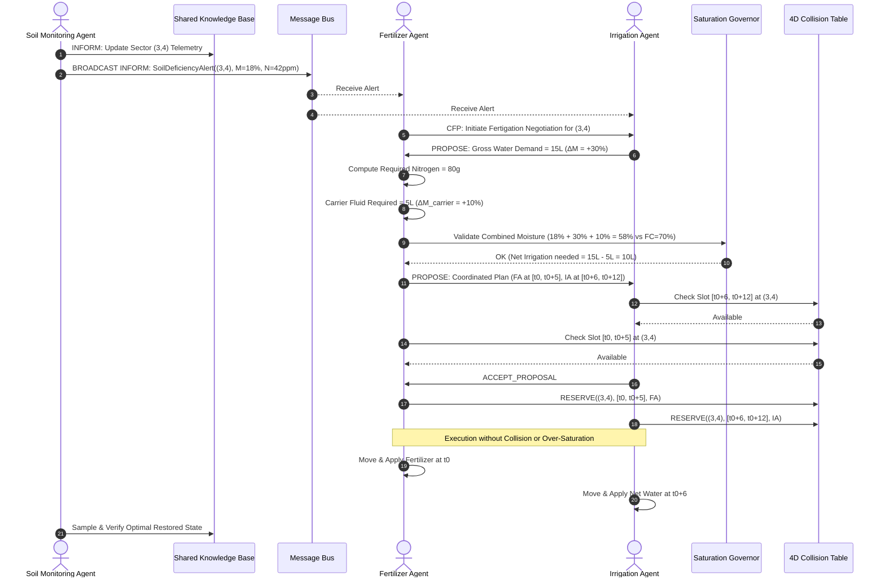

# 📐 Krishi-Karyastan: Formal Architectural Specification

This document provides the formal mathematical and multi-agent systems (MAS) specification for the **Krishi-Karyastan** Precision Agriculture Cooperative.

---

## 1. Environment Formalization: Partially Observable Farm Grid

The physical farm is formalized as a partially observable discrete-time system:

$$\mathcal{S} = \langle \mathcal{G}, \mathcal{T}, \mathcal{W}, \mathcal{A} \rangle$$

Where:
- $\mathcal{G} = \{ (x, y) \mid x \in \{0, \dots, W-1\}, y \in \{0, \dots, H-1\} \}$ is the set of spatial discrete sectors.
- Each sector $s \in \mathcal{G}$ possesses an internal physical state:
  $$\mathbf{x}(s, t) = \begin{bmatrix} M(s, t) \\ N(s, t) \\ P(s, t) \\ K(s, t) \\ pH(s, t) \\ C(s, t) \\ \Omega(s, t) \end{bmatrix} \in \mathbb{R}^7$$
  - $M(s, t) \in [0, 100]$: Volumetric Soil Moisture content (%).
  - $N, P, K \in [0, 500]$: Available Nitrogen, Phosphorus, Potassium (mg/kg or ppm).
  - $pH \in [4.0, 9.0]$: Soil acidity/alkalinity.
  - $C(s, t) \in \{\text{Vegetative}, \text{Flowering}, \text{Ripening}, \text{Mature}\}$: Crop phenological stage.
  - $\Omega(s, t) \in [0.0, 1.0]$: Pest / Pathogen infestation index.
- $\mathcal{W}(t)$: Environmental weather vector (ambient temperature $T_{amb}$, solar radiation $I_{sun}$, rainfall $R_{rain}$, humidity $H_{amb}$).

### Partial Observability & Perception Model
Let agent $i \in \mathcal{A}$ be positioned at physical coordinates $\mathbf{p}_i(t) = (x_i, y_i) \in \mathcal{G}$. Agent $i$ possesses a sensing radius $R_i$. The agent's observation at tick $t$ is:

$$\mathcal{O}_i(t) = \{ (s, \mathbf{z}_i(s, t)) \mid s \in \mathcal{G}, \|\mathbf{p}_i(t) - s\|_2 \le R_i \}$$

Where $\mathbf{z}_i(s, t) = \mathbf{x}(s, t) + \boldsymbol{\epsilon}$, with $\boldsymbol{\epsilon} \sim \mathcal{N}(\mathbf{0}, \boldsymbol{\Sigma}_{\text{sensor}})$.
Sectors outside $R_i$ are completely unobserved by agent $i$ at time $t$. Hence, individual agents operate under strictly **partial observability**.

---

## 2. Dynamic Knowledge Representation & Belief Fusion

To overcome partial observability, agents communicate local percepts to construct a decentralized / shared spatial Knowledge Base (KB).

### Belief State Representation
For each sector $s \in \mathcal{G}$, the knowledge base maintains a belief:

$$\mathcal{B}(s, t) = \langle \hat{\mathbf{x}}(s, t), \tau(s), c(s, t) \rangle$$

- $\hat{\mathbf{x}}(s, t)$: Estimated sector attributes.
- $\tau(s)$: Timestamp of the most recent observation update.
- $c(s, t) \in [0, 1]$: Confidence factor.

### Staleness & Uncertainty Decay
Due to natural evaporation, crop nutrient absorption, and environmental fluctuations, soil beliefs decay in certainty over elapsed time $\Delta t = t - \tau(s)$:

$$c(s, t) = c_0 \cdot \exp(-\lambda_{\text{decay}} \cdot (t - \tau(s)))$$

Where $\lambda_{\text{decay}} > 0$ is the decay constant calibrated to ambient conditions:
$$\lambda_{\text{decay}} = \lambda_0 \cdot \left(1 + \alpha_T \frac{T_{amb}}{30^\circ\text{C}} + \alpha_{sun} \frac{I_{sun}}{I_{max}}\right)$$

### Observation Fusion
When an agent reports a new observation $\mathbf{z}_{new}$ with confidence $c_{obs}$:
$$\hat{\mathbf{x}}_{\text{updated}} = \frac{c(s, t) \cdot \hat{\mathbf{x}}(s, t) + c_{obs} \cdot \mathbf{z}_{new}}{c(s, t) + c_{obs}}$$
$$c_{\text{updated}} = \min\left(1.0, c(s, t) + c_{obs} \cdot (1 - c(s, t))\right)$$
$$\tau(s) \leftarrow t$$

---

## 3. Communication Protocol (FIPA-ACL)

Inter-agent messaging conforms to the IEEE FIPA-ACL (Agent Communication Language) standard:

```json
{
  "message_id": "msg_018f3a9e-4c7b-7b21-8f43-e6b7d23a1098",
  "conversation_id": "conv_patch_repair_sector_3_4",
  "in_reply_to": null,
  "performative": "INFORM",
  "sender": "soil_monitor_alpha",
  "receiver": "shared_knowledge_base",
  "protocol": "fipa_request_inform",
  "content": {
    "type": "SoilDeficiencyAlert",
    "sector": [3, 4],
    "moisture_percent": 18.2,
    "moisture_threshold": 35.0,
    "nitrogen_ppm": 42.0,
    "nitrogen_threshold": 120.0,
    "urgency": "HIGH",
    "timestamp": 128
  }
}
```

### Performatives Implemented
1. `INFORM`: Unconditional belief sharing (e.g., Soil Monitor transmitting sensor telemetry to the KB or broadcasting an alert).
2. `CFP` (Call for Proposals): Coordinator or monitoring agent soliciting intervention plans from actuator agents.
3. `PROPOSE`: Actuator agents submitting action bids (water volume, fertilizer formulation, arrival time window).
4. `ACCEPT_PROPOSAL` / `REJECT_PROPOSAL`: Negotiation convergence or rejection based on constraints.
5. `CONFIRM`: Final reservation commitment in the 4D collision matrix.
6. `CANCEL`: Aborting an action if environmental state shifted dynamically.

---

## 4. Negotiation Logic: Joint Fertigation & Deconfliction

When Sector $s^* = (x^*, y^*)$ is flagged as **dry** ($M < M_{target}$) and **nutrient-poor** ($N < N_{target}$), both the **Irrigation Agent** ($A_{irr}$) and **Fertilizer Agent** ($A_{fert}$) must act. Uncoordinated simultaneous execution causes:
1. **Soil Over-Saturation & Leaching**: Adding liquid fertilizer plus full irrigation simultaneously floods root zones ($M > M_{field\_capacity}$), suffocating roots and washing soluble nitrogen into deep water tables.
2. **Physical Hardware Collisions**: Two mobile robots attempting to occupy sector $(x^*, y^*)$ or crossing transit lanes at identical timestamps.

### Constraint 1: Agronomic Non-Saturation Boundary
Let:
- $M_{current}$ = Current soil moisture (%).
- $M_{FC}$ = Field Capacity (maximum safe moisture before runoff/anaerobic state, typically $\sim 70\%$).
- $\Delta M_{irr}$ = Moisture increase contributed by irrigation water volume $V_{irr}$.
- $\Delta M_{fert}$ = Moisture increase contributed by liquid carrier fluid $V_{fert\_carrier}$.

The joint response must satisfy:

$$M_{current} + \Delta M_{irr} + \Delta M_{fert} \le M_{FC} - \delta_{safety}$$

Where $\delta_{safety} \approx 5\%$ buffer.

#### Co-Fertigation Coupling Rule:
Liquid fertilizer requires a water carrier volume $V_{fert\_carrier} = k_{dilution} \cdot \text{Mass}_{NPK}$.
The Irrigation Agent dynamically adjusts its required water volume:
$$V_{irr\_net} = \max\left(0, V_{irr\_gross} - V_{fert\_carrier}\right)$$

### Constraint 2: 4D Spatio-Temporal Collision Avoidance
Let $\mathcal{R} \subset \mathcal{G} \times \mathbb{N}$ represent the 4D Space-Time Reservation Table:
$$\mathcal{R} = \{ (x, y, t) \mid \text{Reserved by Agent } A \}$$

For an agent $i$ planning a visit to sector $s^*$ during time window $[t_{start}, t_{end}]$:
1. **Target Conflict Check**:
   $$\forall t \in [t_{start}, t_{end}], \quad (s^*, t) \notin \mathcal{R} \setminus \{A_i\}$$
2. **Spatial Safety Margin**:
   $$\forall s' \text{ with } \|s' - s^*\|_\infty \le 1, \quad \text{Buffer enforced for transit safety}.$$

### Negotiation Sequence Diagram


